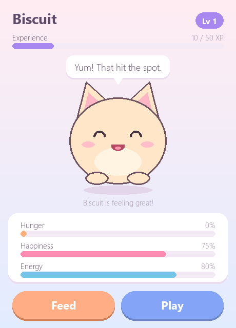

# Desktop Pet

A cute, cozy virtual pet built with Python and Pygame. Name your pet, feed it, play with it, pet it, and watch it level up and grow from a baby into royalty.

The long-term goal is a real desktop companion: a small floating pet that stays on your screen while you use other apps.



## Features

**Working now**

- Name your pet when the game starts (or keep the default, "Mochi")
- A random personality for every pet (cheerful, playful, foodie, sleepy or shy) that flavours what it says
- **Feed** and **Play** buttons, and click the pet to give it a pat
- Hunger, happiness and energy stats that change over time, kept between 0 and 100
- XP and levels, with each level needing a bit more XP than the last
- Five moods (happy, content, hungry, tired, sad), each with its own face and idle animation
- Action animations: munching a cookie, a spinning jump, a squishy wobble when petted, and a head shake when it says no
- Speech bubbles with random lines, plus the pet chatting on its own now and then
- Sound effects, generated in code (no audio files needed), with a mute button
- Visual effects: floating "+XP" text, sparkles, hearts, crumbs, and level-up and evolution bursts
- Four evolution stages, each bigger and with a new accessory
- Automatic saving, with time passing (gently) while the game is closed
- Damaged save files are backed up instead of crashing the game

**Planned**

- Desktop companion mode: a small, draggable, always-on-top window

## Requirements

- Windows (other systems should work but are untested)
- Python 3.10 or newer (developed on Python 3.14)

This project uses [pygame-ce](https://pyga.me/), the community edition of Pygame. Your code still says `import pygame`, and it has ready-made installs for the newest Python versions. The original `pygame` package doesn't support Python 3.14 yet.

## Installation

```powershell
git clone https://github.com/ChompD/buchowchow.git
cd buchowchow
python -m venv .venv
.venv\Scripts\Activate.ps1
pip install -r requirements.txt
```

If PowerShell refuses to run `Activate.ps1`, run this once and try again:

```powershell
Set-ExecutionPolicy -Scope CurrentUser RemoteSigned
```

## Usage

```powershell
python main.py
```

1. Type a name and press **Enter** (or click **Start**).
2. Click **Feed** or **Play**, or click the pet itself.
3. Watch the stats and your pet's mood change over time.

| Action | How | Effect | XP |
|---|---|---|---|
| Feed | Feed button or `F` | Hunger -30, happiness +5. Refused if the pet is already full. | +10 |
| Play | Play button or `P` | Happiness +20, energy -15, hunger +10. Refused if the pet is too tired. | +15 |
| Pet | Click the pet | Happiness +3 (at most once every 4 seconds) | none |
| Mute | Speaker button or `M` | Turns sound effects on or off | |

Over time your pet slowly gets hungrier and less happy, and recovers energy by resting.

### Evolution

Your pet grows as it levels up. Each stage is a bit bigger and unlocks an accessory:

| Stage | Level | Look |
|---|---|---|
| Baby | 1 | Small and round |
| Junior | 3 | Adds a bow |
| Adult | 6 | Full size, with a bell collar |
| Royal | 10 | Wears a crown |

### Saving

Your pet is saved to `save.json` in the project folder:

- when you close the window,
- every 30 seconds while you play,
- right after it evolves.

Next time you start the game, your pet is loaded automatically.

While the game is closed, time still passes for your pet, but 80 times slower, and at most 8 hours count. After a night away it will be hungry and want attention, but it's never in danger.

If the save file is damaged, the game doesn't crash. It renames the file to `save.corrupt-<date>.json` (so nothing is lost) and starts a new pet.

To start over with a new pet, close the game and delete `save.json`.

### Custom sounds

The sound effects are generated in code. To use your own, put a `.wav` or `.ogg` file in `assets/sounds/` named after the effect: `fed`, `played`, `petted`, `refuse`, `level_up` or `click` (for example `assets/sounds/level_up.wav`).

## Running the tests

```powershell
pip install -r requirements-dev.txt
python -m pytest
```

## Project structure

```
buchowchow/
├── main.py              # Window, main loop and screens (naming, game)
├── pet.py               # Pet rules: stats, actions, XP, moods, personality, evolution (no Pygame)
├── save_manager.py      # Saving/loading save.json, offline time, damaged-file backups
├── messages.py          # Everything the pet can say, by situation and personality
├── ui.py                # Drawing: colours, buttons, bars, speech bubble, the pet and its animations
├── effects.py           # Particles, floating text and the level-up / evolution banner
├── sounds.py            # Generated sound effects
├── assets/
│   ├── sprites/         # Custom pet art (coming later)
│   └── sounds/          # Optional custom sound effects
├── tests/               # Tests for the pet rules, saving, messages and sounds
├── docs/screenshot.png
├── requirements.txt     # What you need to play
├── requirements-dev.txt # Extra tools for development (pytest)
└── pyproject.toml       # Test settings
```

The game rules in `pet.py` don't import Pygame, so they can be tested without opening a window.

Animations work as **poses**: each frame, `ui.idle_pose` (for moods) or `ui.action_pose` (for one-off actions) describes how high the pet is, how squished or rotated it is, and which face it makes. `ui.PetRenderer` then draws that pose. To switch to custom sprites later, only `PetRenderer` needs to change.

## Roadmap

- [x] Phase 1: Basic working pet
- [x] Phase 2: Personality and animation
- [x] Phase 3: Progression and saving
- [ ] Phase 4: Desktop companion mode
